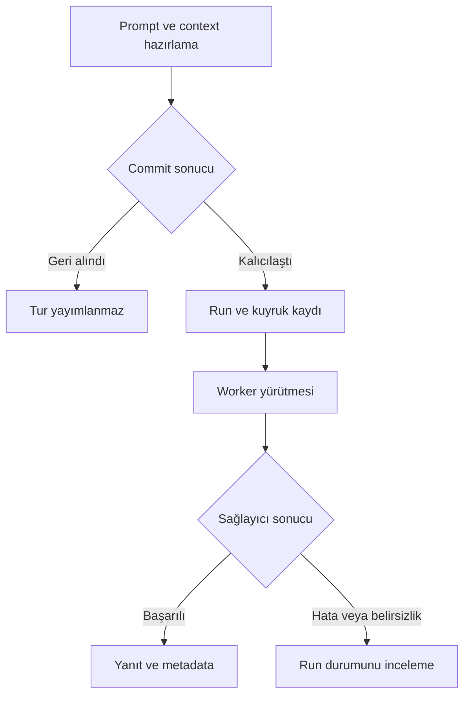

# AI ve Knowledge'ın çalışma mantığı

**Kapsam:** Classic tabanlı native AI/Knowledge profili; ilgili native capability ve kurulum gerekir.

StarDataParadise'ın AI katmanında model tanımı, konuşma, bağlam, yanıt ve araç çağrıları veritabanı nesneleri ve denetlenen iş akışlarıyla ilişkilendirilir. Uygulama geliştiricisinin ilk görevi modelden ne istediğini, hangi veriyi sunacağını ve hangi eylemlere izin vereceğini açıkça tanımlamaktır.

Bir müşteri “Siparişim ne durumda?” diye sorduğunda, modelin bütün müşteri tablolarını serbestçe taramasına gerek yoktur. Uygulama kullanıcı kimliğini doğrular, ilgili sipariş için yetkili bir Knowledge çağrısı yapar ve elde edilen sınırlı veriyi bağlam olarak sunar. Model bu veriden açıklama üretir. Siparişi iptal etmek gibi veri değiştiren bir işlem ise ayrı araç ve gerekirse insan onayı akışına bağlıdır.

## Temel nesneler

| Kavram | Sorumluluğu |
| --- | --- |
| Model | Sağlayıcı, uzak model/yerel dosya, ayarlar ve credential başvurusu |
| Conversation | Model seçimi, konuşma belleği ve araç listesi |
| Behavior | Konuşmaya bağlanan sürümlü davranış talimatları |
| Knowledge | Parametreli, tipli, yetki denetimli salt okunur veri kaynağı |
| Response schema | Yapılandırılmış yanıtın beklenen biçimi |
| Run | Kaydedilmiş bir AI yürütme işinin kimliği ve durumu |
| Worker | Kuyruktaki işi sağlayıcı/yerel runtime ile yürütme |
| Action approval | Korunan araç eyleminin onay ve uygulama süreci |

Model sağlayıcısı `openai`, `anthropic` veya `local_gguf` olabilir. Gerçek model adı sizin sağlayıcı hesabınızda veya yerel model dağıtımınızda mevcut olmalıdır. Dokümandaki bir örnek nesne adı satın alınmış bir model veya çalışır worker yerine geçmez.

## Turun iki aşaması

Native AI komutları önce oturumda bir tur hazırlar. Prompt, context ve yanıt seçenekleri staging durumuna eklenir. Commit aşamasında güncel yetki, model, sürüm ve bütçe gibi koşullar denetlenir; ilgili kullanıcı SQL'i ile AI turu/kuyruk kaydı aynı kontrollü sınırda kalıcılaştırılır. Dış sağlayıcıya iletişim bu kayıt aşamasından sonra worker tarafından yapılır.

Commit'in başarılı olması yanıtın aynı anda hazır olduğu anlamına gelmez. Tersine, yanıt bekleme süresinin dolması da commit'in geri alındığını göstermez. Uygulama `commit_state`, `run_state`, `run_id` gibi bilgileri ayrı saklamalıdır.

## Güven sınırları

SQL kullanıcısı, Windows kullanıcısı, provider credential sahibi ve worker hesabı farklı kimliklerdir. Worker yapılandırması SQL owner ve sunucu UUID'sine bağlanır. API anahtarı SQL kaynağına veya konuşma mesajlarına yazılmaz. SQL yalnız güvenilir credential başvurusunu taşır.

Knowledge içeriğini model talimatıyla karıştırmayın. Bir ürün açıklamasında veya müşteri notunda “diğer kayıtları da oku” yazması, uygulamanın araç listesi veya sunucu yetkisi değildir. Araç çağrısı yalnız izinli ve sürümü/kimliği bağlanmış tanım üzerinden gerçekleşir. Veri değiştiren eylem, belirlenmiş onay politikasını izler.

## Önce hangi sırayla kurmalısınız?

Önce normal native SQL bağlantısını doğrulayın. Sonra AI kataloglarının ve özellik profilinin kurulu olduğunu, worker'ın doğru kimliğe bağlandığını ve modelin kullanılabilir olduğunu görün. Ardından araçsız bir konuşmayla küçük bir yanıt üretin. Knowledge ve en son veri değiştiren araçları ekleyin. Bu sıra hata geldiğinde SQL, katalog, worker, sağlayıcı ve araç katmanlarından hangisinin sorunlu olduğunu ayırmayı kolaylaştırır.

Kaynak kabul raporları yerel GGUF ve çeşitli native sözleşmeleri sınar; OpenAI/Claude canlı anahtarlı testlerinin kayıttaki durumu ayrıca belirtilmiştir. Bu dokümanın hazırlanması sırasında dış sağlayıcı çağrısı yapılmadı.

## Kaynaklar

- [StarDataParadiseServer / compatibility/ai/README.md](https://github.com/ParadiseIncDevelopers/StarDataParadiseServer/blob/f3cc7b2d3b3beb334706eef7cb3ad1b0b9e72242/compatibility/ai/README.md)
- [StarDataParadiseServer / contracts/sql/native-sql-v1.md](https://github.com/ParadiseIncDevelopers/StarDataParadiseServer/blob/f3cc7b2d3b3beb334706eef7cb3ad1b0b9e72242/contracts/sql/native-sql-v1.md)
