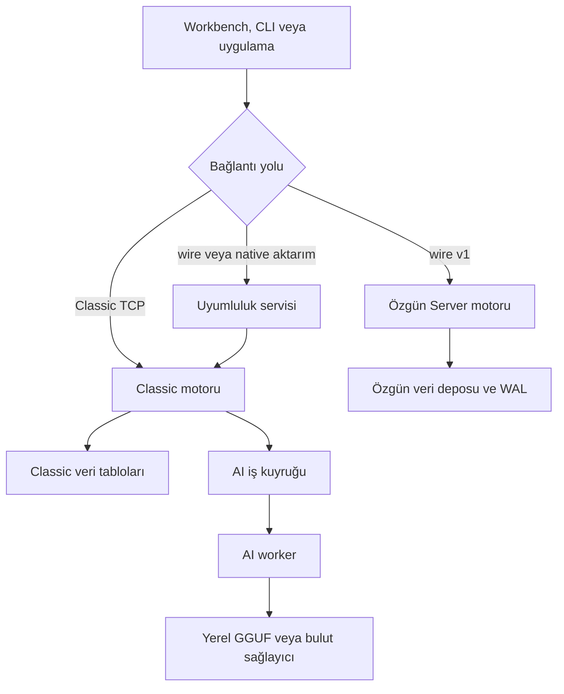

# Mimari ve isteklerin izlediği yol

**Kapsam:** Özgün wire v1, Classic/native SQL ve AI worker ayrımı.

Bir uygulama veritabanına bağlandığında yalnızca bir ağ soketi açmış olmaz. Önce sunucu kimliği TLS ile doğrulanır, ardından kullanıcı kimliği doğrulanır ve sunucunun desteklediği yetenekler öğrenilir. SQL ifadesi hazırlanır, parametreler ayrı değerler olarak bağlanır, sonuç okunur ve gerekiyorsa transaction kalıcılaştırılır. Bu zincirin herhangi bir noktasındaki hata aynı anlama gelmez.

Şemadaki yollar alternatif bağlantı yollarıdır; her kurulumda hepsinin çalışması gerekmez. Portlar yapılandırmaya aittir. `7443`, `7401` ve `3197` örnekleri başka bir makinedeki hizmetin kimliğini kanıtlamaz.

## Bağlantı, oturum, ifade ve sonuç

**Bağlantı**, uygulama ile sunucu arasındaki iletişim kanalıdır. **Oturum**, bu kanal üzerinde doğrulanmış kullanıcıya ve geçici çalışma durumuna bağlanır. Açık transaction, hazırlanmış ifadeler ve sonuç okuyucuları oturum yaşam döngüsünün parçalarıdır. Aynı bağlantıyı iki bağımsız iş için eşzamanlı kullanmak, bu durumların karışmasına yol açabileceği için SDK kurallarına aykırıdır; paralel işler ayrı bağlantılar kullanır.

**Hazırlanmış ifade**, SQL kaynağını ve beklenen parametreleri sunucuya tanıtır. SQL metniyle kullanıcı girdisini birleştirmek yerine değerleri bağlarsınız. Örneğin ürün kimliği SQL'in yapısını değiştirmez; `:id` veya ilgili API'de `?` için bir değer olur.

**Sonuç okuyucusu**, tüm satırların uygulamaya aynı anda yüklenmesini gerektirmeden sonucu tüketir. Wire yolunda açık okuyucu kapanmadan yeni işlem yapılamayan durumlar vardır. Sonucu yarıda bırakıyorsanız SDK'nın kapatma/iptal yöntemini kullanın. `Statement` kapatma, transaction commit ve bağlantı kapatma birbirinden farklı eylemlerdir.

## Bir yazma işlemi nasıl düşünülmeli?

Bir sipariş için stok azaltma, sipariş başlığı ekleme ve kalemleri ekleme aynı iş birimine aittir. Uygulama transaction'ı açar, ifadeleri sırayla yürütür, her birinin beklenen satır sayısını kontrol eder ve commit ister. İş kuralı sağlanmıyorsa rollback yapar. Ağ kesildiğinde ise “cevap gelmedi” ile “sunucu işlemi uygulamadı” birbirine eşit değildir.

Wire yazmalarında request token ve outcome sorgusu bu belirsizliği yönetmek için vardır. Native SQL yolu aynı genel CRUD makbuz sözleşmesini kullanmaz; AI run kimliği veya uygulamanın kalıcı iş kaydı üzerinden durum okunur. [Hata ve sonuç yönetimi](../referans/hatalar.md) bu ayrımı ayrıntılandırır.

## AI neden ayrı worker kullanır?

Uzak bir modele yapılan çağrı uzun sürebilir. AI turunun kaydı ile dış sağlayıcının yanıtı farklı aşamalardır. Native AI commit akışı kullanıcı verisi, tur ve kuyruk kaydını denetlenen transaction sınırında yazar; worker dış sağlayıcıyla daha sonra iletişim kurar. Böylece dış model çağrısını beklerken business SQL kilitlerini açık tutan bir uygulama tasarımından kaçınılır.

Worker'ın kimliği, uygulama kullanıcısının bütün tablo yetkilerini devralmaz. Model sağlayıcı kimlik bilgisi, sunucu UUID'si, SQL owner ve izinli araçlar ayrı bağlarla denetlenir. Bu yüzden Workbench'te API anahtarını kaydetmek, worker çalışıyor veya gerçek bir inference çağrısı başarılı oldu demek değildir.

## Uygulama katmanında sorumluluk paylaşımı

Sunucu veri bütünlüğünü, yetkileri ve transaction sözleşmesini uygular. SDK bu sözleşmeyi dilin türleri ve kaynak yönetimiyle sunar. Uygulamanız ise sipariş kimliği üretme, iş kuralı doğrulama, tekrar gelen HTTP isteğini tekilleştirme ve kullanıcıya durum gösterme sorumluluğunu taşır. Bu katmanları ayırmak hatanın nerede ele alınacağını açık hale getirir.

## Kaynaklar

- [StarDataParadiseServer / README.md](https://github.com/ParadiseIncDevelopers/StarDataParadiseServer/blob/f3cc7b2d3b3beb334706eef7cb3ad1b0b9e72242/README.md)
- [StarDataParadiseServer / contracts/sql/native-sql-v1.md](https://github.com/ParadiseIncDevelopers/StarDataParadiseServer/blob/f3cc7b2d3b3beb334706eef7cb3ad1b0b9e72242/contracts/sql/native-sql-v1.md)
- [StarDataParadiseServer / compatibility/wire_v1/README.md](https://github.com/ParadiseIncDevelopers/StarDataParadiseServer/blob/f3cc7b2d3b3beb334706eef7cb3ad1b0b9e72242/compatibility/wire_v1/README.md)
- [StarDataParadiseServer / compatibility/ai/README.md](https://github.com/ParadiseIncDevelopers/StarDataParadiseServer/blob/f3cc7b2d3b3beb334706eef7cb3ad1b0b9e72242/compatibility/ai/README.md)
