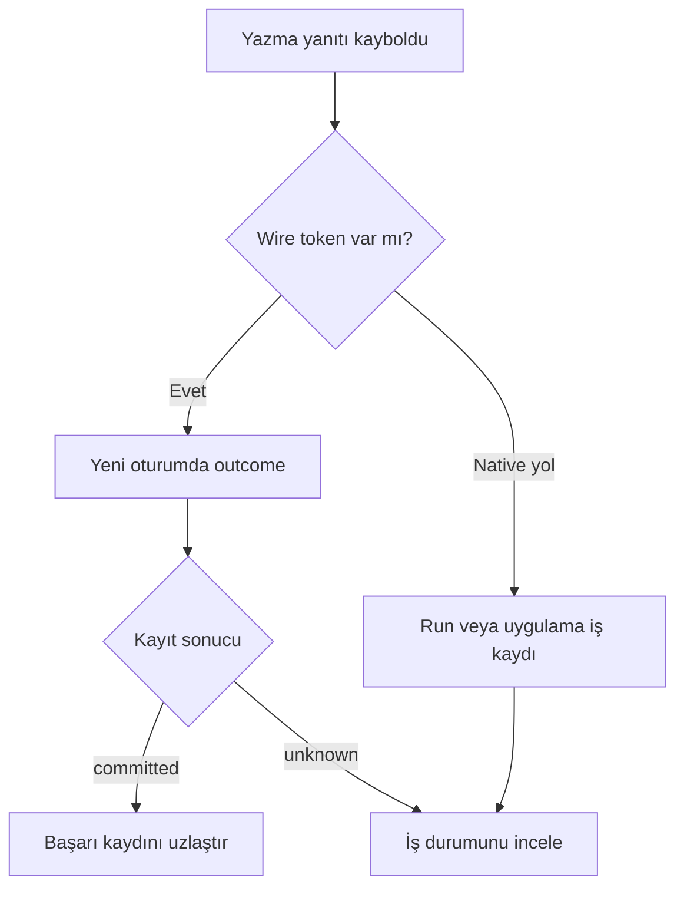

# Hataları teşhis etmek ve sonucu korumak

**Kapsam:** Bütün istemciler için karar akışı; gerçek alan/metot adları SDK'ya göre değişir.

Bir hata mesajı geldiğinde önce isteğin hangi aşamada olduğunu belirleyin. Bağlantı hiç açılmadıysa inceleyeceğiniz alanlarla, commit isteği gönderildikten sonra yanıt kaybolduğunda inceleyeceğiniz alanlar farklıdır. Uygulama bu durumları aynı “yeniden dene” düğmesine bağlamamalıdır.

## Hızlı teşhis tablosu

| Belirti | Önce kontrol edin | Uygun devam |
| --- | --- | --- |
| Connection refused | Server süreci, LISTENING, adres/port | Doğru dinleyiciyi açma/bağlanma |
| TLS name/chain hatası | SAN, TLS adı, CA ve sertifika zamanı | Güven ve isim ayarını düzeltme |
| Auth başarısız | Kullanıcı, parola, hesap etkinliği, doğru instance | Kimlik bilgisini doğru akışla düzeltme |
| Permission denied | Çağıran hesap, etkin haklar, hedef nesne | Gerekli dar hakkı değerlendirme |
| SQL syntax | Özgün mü native mi, grammar kapsamı | Doğru profile ait komut kullanma |
| Feature unsupported | Capability, storage ve modül kurulumu | Sunucu profilini doğrulama |
| Açık result/invalid state | Tüketilmemiş okuyucu, aynı bağlantıda paralellik | Sonucu kapatma, çağrıları sıralama |
| Constraint hatası | PK/FK/UNIQUE/CHECK ve yazma sırası | İş kuralını/girdiyi düzeltme |
| Belirsiz yazma | İstek gönderildi mi, token/run var mı | Kalıcı sonucu sorgulama |
| AI queued | Worker kimliği, model bağı ve worker durumu | Doğru iş katmanını inceleme |

## Wire yazma sonucunu kurtarma

Token taşıyan bir yazma veya commit yanıtı kaybolduğunda hata nesnesi belirsiz sonucu işaretleyebilir. İlk isteğin token'ını koruyun; aynı kimlikle yeni bağlantı açın ve SDK'nın outcome metodunu çağırın. CLI'da karşılığı `\outcome TOKEN` komutudur.

`unknown` işlemin başarısız olduğunu göstermez. Kayıt yok, süresi geçmiş veya sonuç kanıtlanamıyor olabilir. Makbuz yokluğundan otomatik rollback sonucu çıkarmayın. Aynı request token'ını yeni bir bağımsız iş için de kullanmayın.

## Native hata alanlarını birlikte okuyun

Native SQL genel wire CRUD receipt token'ı üretmez. Hata `code`, `native_errno`, `sqlstate`, `phase`, `commit_state`, `run_state`, `run_id` ve `unknown_outcome` gibi alanlar taşıyabilir. Bir AI bekleme timeout'u, `commit_state: committed` ile gelmişse ilk tur kaydedilmiştir; run durumu okunmalıdır.

Araç çağrısında `action_commit_state`, AI turunun commit durumundan ayrıdır. AI turu committed, araç rolled_back olabilir. Asıl timeout veya SQL nedenini `cause_native_errno` gibi alanlar koruyabilir. Uygulamada yalnız üst hata metnini saklamak, bu ayrımı kaybettirir.

## Tekrar deneme politikası

Bir okumanın tekrar edilmesi ile bir yazmanın tekrar edilmesi aynı politika değildir. Kaynak SDK'larda yalnız belirli güvenli okuma durumlarına yönelik sınırlı retry seçenekleri bulunabilir; bunu bütün sorgulara genellemeyin. Mutation/commit için önce sonucu ve uygulamanın tekilleştirme kaydını değerlendirin.

Sipariş kimliğinin benzersiz olması yinelenen INSERT'i engeller, fakat dış sisteme gönderilmiş e-posta veya provider isteğini geri almaz. Uygulama iş kaydı, veritabanı commit'i ve dış etkileri aşamalı tasarlayın. Timeout olduğunda aynı iş kimliği üzerinden durum sormak, yeni iş kimliği üreterek tekrar başlatmaktan farklıdır.

## Destek için küçük, anlamlı bir kayıt

Olay zamanı, SDK/Server sürümü, bağlantı profili türü, işlem adı, hata kodu/SQLSTATE, correlation ID ve varsa token/run/call kimliğini kaydedin. Kullanıcının bütün sorgusunu, parolasını ve provider yanıtını koşulsuz loglamayın. Bir sorunu yeniden üretirken boş bir eğitim instance'ı ve sınırlı örnek veri kullanmak, hatanın veri, yetki veya protokol katmanını ayırmayı kolaylaştırır.

## Kaynaklar

- [StarDataParadiseServer / contracts/sql/native-sql-v1.md](https://github.com/ParadiseIncDevelopers/StarDataParadiseServer/blob/f3cc7b2d3b3beb334706eef7cb3ad1b0b9e72242/contracts/sql/native-sql-v1.md)
- [StarDataParadiseServer / compatibility/wire_v1/README.md](https://github.com/ParadiseIncDevelopers/StarDataParadiseServer/blob/f3cc7b2d3b3beb334706eef7cb3ad1b0b9e72242/compatibility/wire_v1/README.md)
- [StarDataParadiseDLLler / ABI.md](https://github.com/ParadiseIncDevelopers/StarDataParadiseDLLler/blob/3199235c9641733332e9b8c82f9e875170c4eedb/ABI.md)
- [StarDataParadiseCli / CLI.md](https://github.com/ParadiseIncDevelopers/StarDataParadiseCli/blob/95f07c6046662bfc3a49dc2ccced36898b0db07b/CLI.md)
